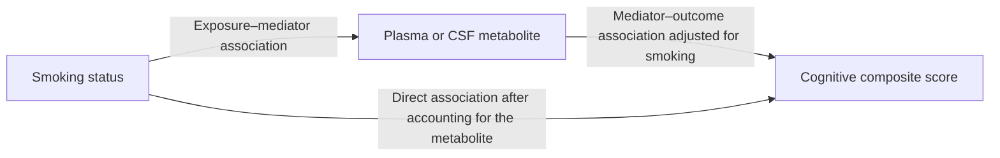

# Assessing the Biological Mechanisms Linking Smoking Behavior and Cognitive Function: A Mediation Analysis of Untargeted Metabolomics

This repository accompanies a longitudinal study of whether metabolites help explain the association between smoking status and cognitive performance. The study used untargeted metabolomics measurements from blood plasma and cerebrospinal fluid (CSF) in the Wisconsin Registry for Alzheimer’s Prevention (WRAP).

[Read the open-access paper](https://www.mdpi.com/2218-1989/13/11/1154) · [Request WRAP data access](https://wrap.wisc.edu/data-requests-2/)

## Study design

The indirect association is estimated along the two paths through the metabolite.

1. Test the association between smoking status and cognitive composite scores.
2. Screen plasma and CSF metabolites for associations with smoking status, accounting for multiple testing.
3. Test whether candidate metabolites are associated with cognitive scores after adjusting for smoking status.
4. Estimate direct and indirect associations for the retained metabolites using the product-of-coefficients approach.

The analysis used linear mixed models to account for repeated visits. The paper’s Methods section describes metabolomics quality control, model covariates, and the use of RMediation to calculate confidence intervals. The study is observational, so the mediation estimates are interpreted as evidence of potential pathways.

## Code and data access

This repository contains project documentation. The original analysis code and participant-level data are restricted and are not distributed here. Researchers can apply for data through the [WRAP resource request process](https://wrap.wisc.edu/data-requests-2/). Published methods, tables, and supplementary figures are available through the [article](https://www.mdpi.com/2218-1989/13/11/1154).

## Citation

Choi, J. J., Koscik, R. L., Jonaitis, E. M., Panyard, D. J., Morrow, A. R., Johnson, S. C., Engelman, C. D., & Schmitz, L. L. (2023). Assessing the Biological Mechanisms Linking Smoking Behavior and Cognitive Function: A Mediation Analysis of Untargeted Metabolomics. *Metabolites*, 13(11), 1154. [doi:10.3390/metabo13111154](https://doi.org/10.3390/metabo13111154)
